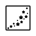
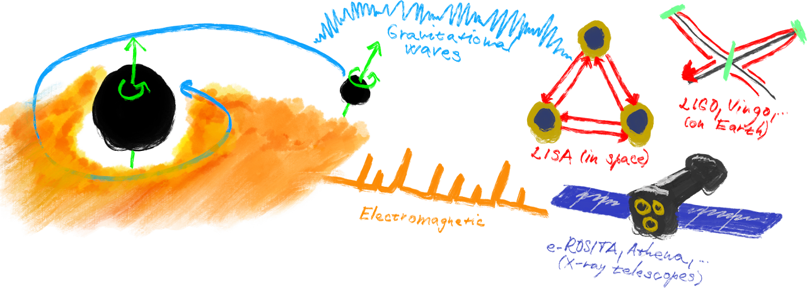
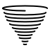
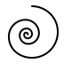
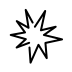
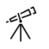

#  Research

Roughly speaking, much of my research could be summarised as attempting to answer
questions such as "How do things behave near black holes? How do they move? How do
they evolve?" and, to some degree also "How can we observe all of that?".

What these "things" are can vary quite a bit. They can be speckles of dust, other
black holes, neutron stars, "ordinary" stars, or even clouds of magnetised plasma
orbiting black holes in accretion disks. The gravitational fields in which these
dynamics play out can be those of isolated, rotating, or non-rotating black holes,
or black holes perturbed by the presence of surrounding matter. The observational
window can range from radio dishes on Earth to gravitational-wave detectors and
X-ray telescopes in space. To answer all of these questions I use advanced
mathematical techniques and numerical simulations.

For an up-to-date list of publications see my
[ArXiv](https://arxiv.org/search/?searchtype=author&query=Witzany%2C+V),
[InspireHEP](https://inspirehep.net/authors/1436457), or
[Google Scholar](https://scholar.google.com/citations?user=6ErvxkMAAAAJ) profiles,
or the [Publications](../publications) page on this site.

---

## Key research threads

###  Spinning bodies in curved spacetime

The motion of compact objects with spin introduces rich new mathematical structure.
Together with collaborators I have developed Hamilton-Jacobi and action-angle
frameworks that yield closed-form analytic solutions for spinning-particle orbits —
first around Schwarzschild black holes
([PRL 132, 171401, 2024](https://arxiv.org/abs/2308.00021)) and more recently in the
full Kerr metric ([PRL 134, 171401, 2025](https://arxiv.org/abs/2411.16855)).
Earlier work established the general Hamiltonian framework
([CQG 36, 075003, 2019](https://arxiv.org/abs/1808.06582)) and solved the
Hamilton-Jacobi equation for spinning particles at first order in spin
([PRD 100, 104030, 2019](https://arxiv.org/abs/1903.03651)).

###  EMRI dynamics and waveform modelling

Extreme mass ratio inspirals (EMRIs) — compact objects spiralling into massive black
holes — are among the most promising sources for the future LISA detector. I work on
accurate inspiral models including orbital resonances
([CQG 41, 225002, 2024](https://arxiv.org/abs/2405.21072)),
spinning-body corrections
([PRD 110, 084061, 2024](https://arxiv.org/abs/2406.14291);
[PRD 112, 124054, 2025](https://arxiv.org/abs/2506.20726)),
and environmental effects such as surrounding matter
([PRD 106, 044069, 2022](https://arxiv.org/abs/2205.08516);
[PRD 112, 104003, 2025](https://arxiv.org/abs/2507.15720)).
I am a contributing author to the comprehensive
[LISA Consortium waveform review](https://arxiv.org/abs/2311.01300).

###  Quasi-periodic eruptions and multi-messenger astrophysics

I collaborate on the interpretation of X-ray quasi-periodic eruptions (QPEs) observed
by eROSITA and XMM-Newton in the nuclei of nearby galaxies. These recurring X-ray
flares are candidate electromagnetic counterparts of EMRI-like events, and their
long-term monitoring constrains both the orbital dynamics and the accretion
environment around the central black hole.

###  Accretion disk theory

Earlier work addressed analytical solutions for geometrically thick fluid tori
([A&A 614, A75, 2018](https://arxiv.org/abs/1711.09241)),
pseudo-Newtonian evolution schemes for accretion flows
([ApJ 841, 105, 2017](https://arxiv.org/abs/1601.01034)),
conservation laws in MHD flows
([PRD 96, 064019, 2017](https://arxiv.org/abs/1612.09308)),
and the hidden symmetry of rotating black holes and its implications for simulations
([MNRAS 473, 2434, 2017](https://arxiv.org/abs/1709.03330)).
