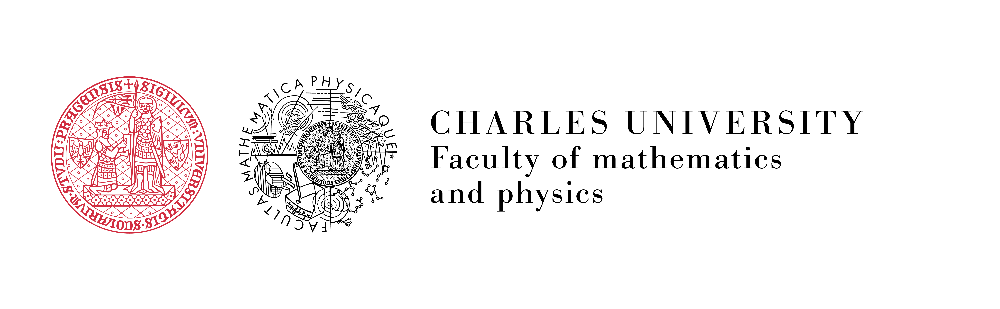

#  Team

I lead a small research group at the Institute of Theoretical Physics, supported by
the [Primus](https://cuni.cz/UKEN-558.html) and [GAČR](https://gacr.cz/en/) grants.

## Current members

**Lukáš Polcar** — postdoc (started August 2023)  
Research focus: EMRIs in environments with surrounding matter; relativistic orbital dynamics.

**Viktor Skoupý** — postdoc (started October 2023)  
Research focus: Spinning-body dynamics in Kerr spacetime; post-Newtonian expansions of EMRIs.

**Angelica Albertini** — postdoc (started 2025)  
Research focus: Effective-one-body waveform models for large-mass-ratio binaries; comparison with gravitational self-force results and spinning-body dynamics.

**Álvaro Rafael Martínez Gómez** — PhD student (started October 2023)

**David Podrápský** — PhD student (started June 2026)

---

The team is embedded within the broader Relativity group at the
[Institute of Theoretical Physics](https://utf.mff.cuni.cz/), under the
[Faculty of Mathematics and Physics](https://mff.cuni.cz/) of
[Charles University in Prague](https://cuni.cz/).
Staff members of the Relativity group include professors Pavel Krtouš, David Kubizňák,
and Jiří Podolský, associate professors David Heyrovský, Tomáš Ledvinka, Oldřich Semerák,
Otakar Svítek, Robert Švarc, and Martin Žofka, assistant professor Sante Carloni,
and a number of research fellows and postdocs.

